# 圳行Agent · Zhenhang Agent

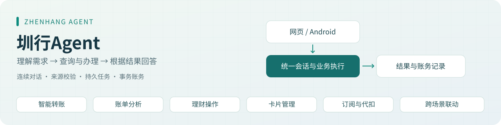

圳行Agent把账户查询、转账、账单分析、理财、信用卡和订阅服务放进一个对话入口。用户可以分几次把需求说清楚，也可以改金额、换银行卡，办理后继续追问结果。网页和 Android 应用使用同一套后端服务。

模型先判断用户想做什么、需要查询哪些资料。服务器核对卡片、金额、权限和办理条件；涉及资金或授权变更时，用户先在页面核对并确认，系统随后执行并保存结果。

**主要技术：** Python / FastAPI / Pydantic / SQLAlchemy · React 19 / TypeScript / Vite · DeepSeek V4 Pro · PostgreSQL 16 / pgvector · 本机多语言 Embedding · Java / Android WebView · Docker Compose

## 目录

- [界面实录](#界面实录)
- [用户资料主页](#用户资料主页)
- [场景对话与办理](#场景对话与办理)
- [六场景覆盖](#六场景覆盖)
- [一轮对话如何处理](#一轮对话如何处理)
- [连续对话与结果追问](#连续对话与结果追问)
- [关键技术与源码](#关键技术与源码)
- [信用卡多步流程与DAG](#信用卡多步流程与dag)
- [风控、确认与幂等](#风控确认与幂等)
- [知识检索与模型选择](#知识检索与模型选择)
- [网页、Android与管理后台](#网页android与管理后台)
- [评测与验证记录](#评测与验证记录)
- [快速启动](#快速启动)
- [初始化数据](#初始化数据)
- [工程目录与开发验证](#工程目录与开发验证)
- [适用范围与待接入能力](#适用范围与待接入能力)

## 界面实录

以下画面来自2026-10-24至29的实际运行与录制。点击图片可查看原图，页面中的金额和卡片状态为采集当时的业务结果。

### 用户资料主页

在同一入口查看账户、持仓、订阅和家庭资料，再返回对话发起查询或办理。下面展示2026-10-25运行时的资料页；卡片状态、持仓和已开通服务会随业务变化。

| 账户与借记卡：独立余额、币种和卡片状态 | 资产持仓：理财、股票与贵金属 |
| --- | --- |
| [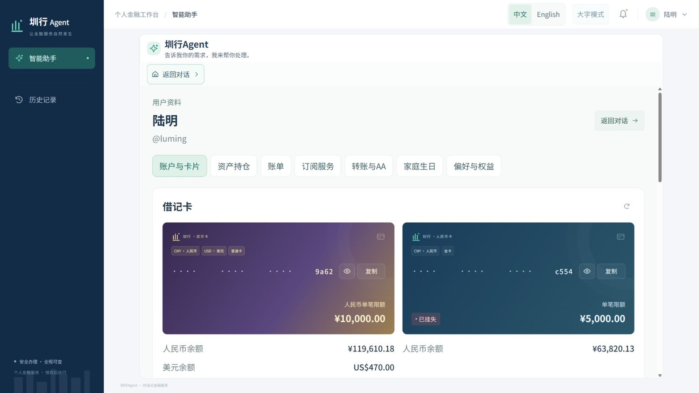](docs/screenshots/profile-accounts.png) | [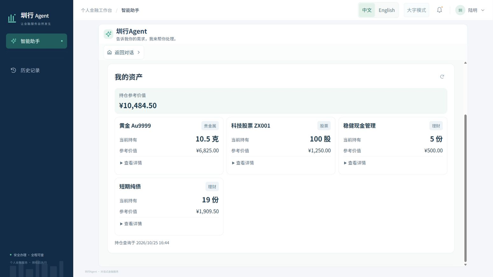](docs/screenshots/profile-assets.png) |
| **订阅服务：费用、权益和自动续费设置** | **家庭与生日：成员关系和生日安排** |
| [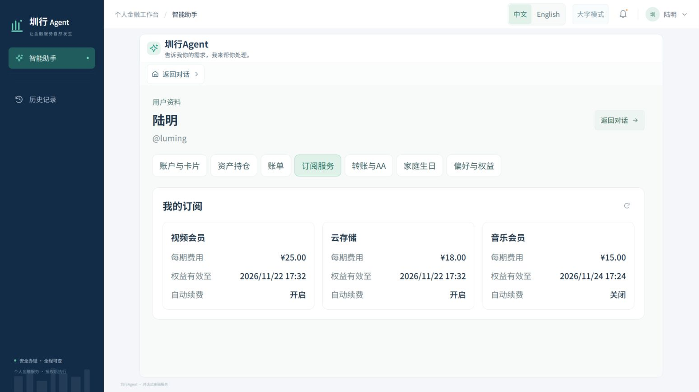](docs/screenshots/profile-subscriptions.png) | [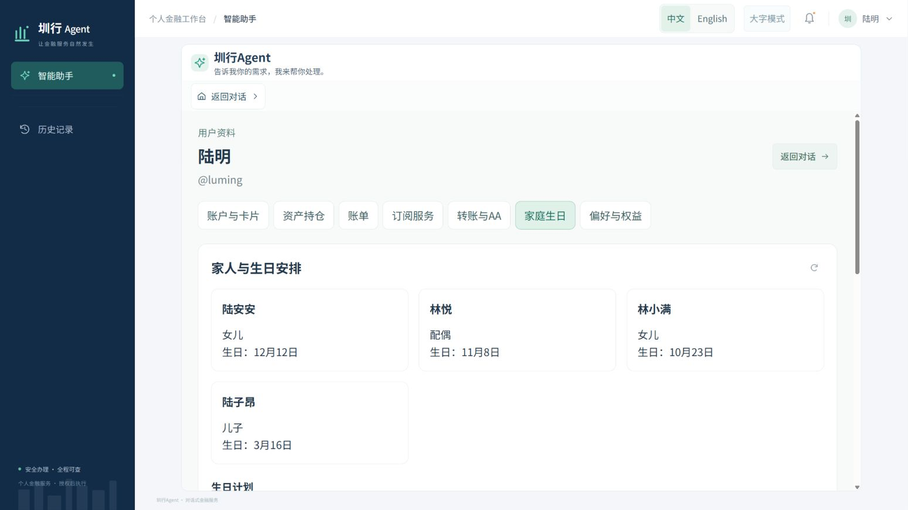](docs/screenshots/profile-family.png) |

### 场景对话与办理

**连续补充与转账结果**：从“给林悦转一笔钱”继续补充付款卡，完成后显示收款人、收款卡、备注与转账状态。

[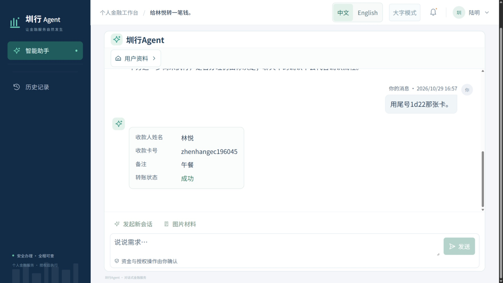](docs/screenshots/transfer-dialogue.jpg)

| 月度账单与待核对扣款 | 申购后追问当前持仓 |
| --- | --- |
| [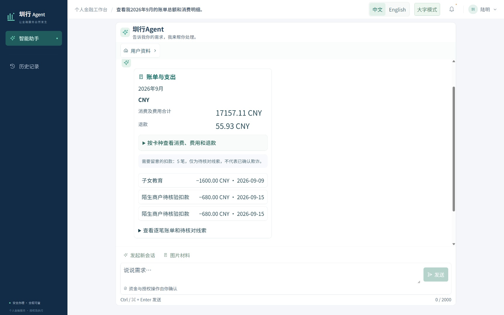](docs/screenshots/bill-analysis.jpg) | [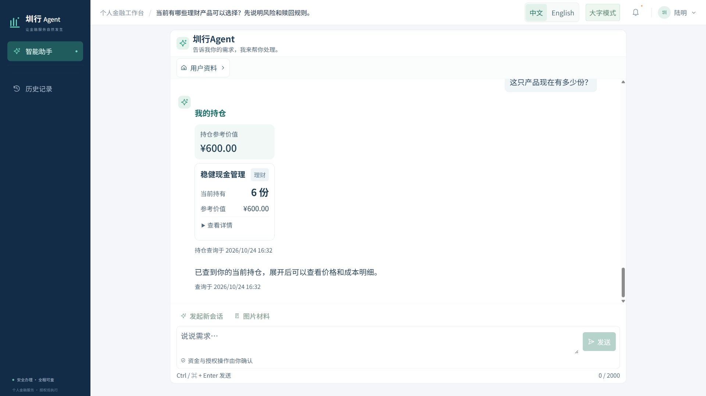](docs/screenshots/wealth-holdings.jpg) |
| **订阅价格与续费规则咨询** | **每月交房租预约登记** |
| [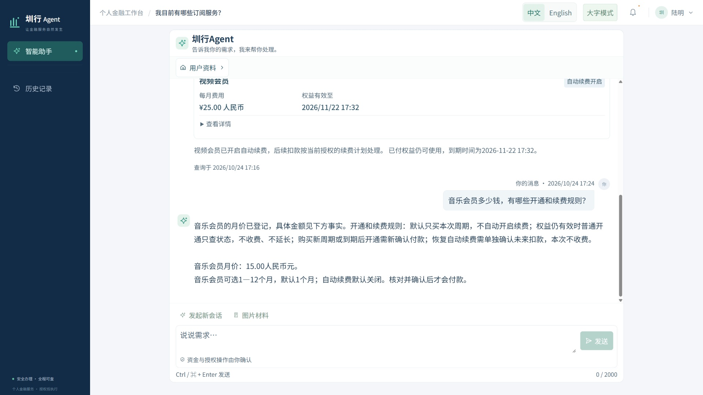](docs/screenshots/subscription-consultation.jpg) | [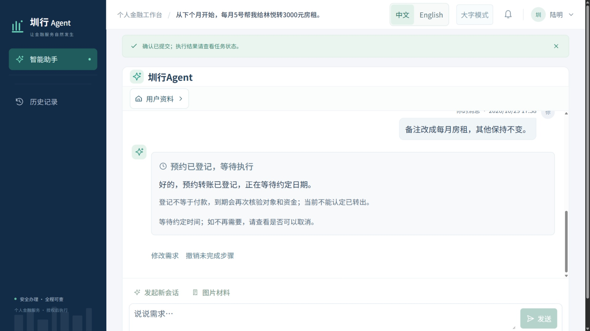](docs/screenshots/rent-schedule.jpg) |
| **AA收款：查询谁已付款、是否收齐** | **信用卡：还清后复查欠款和可用额度** |
| [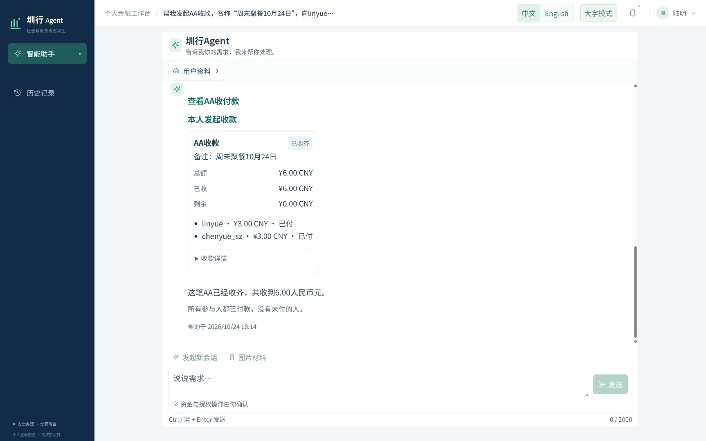](docs/screenshots/aa-collection.jpg) | [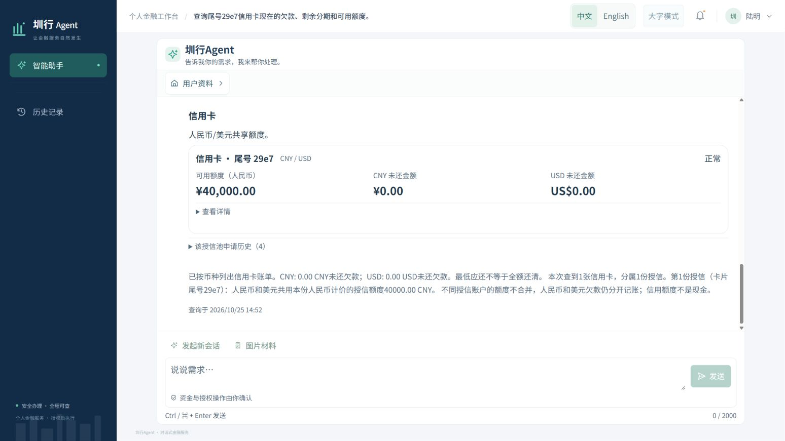](docs/screenshots/credit-requery.png) |

用户接着说“这只产品”“这张信用卡”或“这笔AA”时，系统会找到前面正在讨论的那一项，再查询对应结果。转账和还款需要用户在页面核对并确认后才执行。

<details>
<summary>展开查看房租预约的8期执行安排</summary>

“从下个月开始，每月5号转3000元房租”，再补充结束月份后，系统列出2026年11月至2027年6月共8期待执行安排。登记与待执行状态分别展示，不能当作已经付款。

[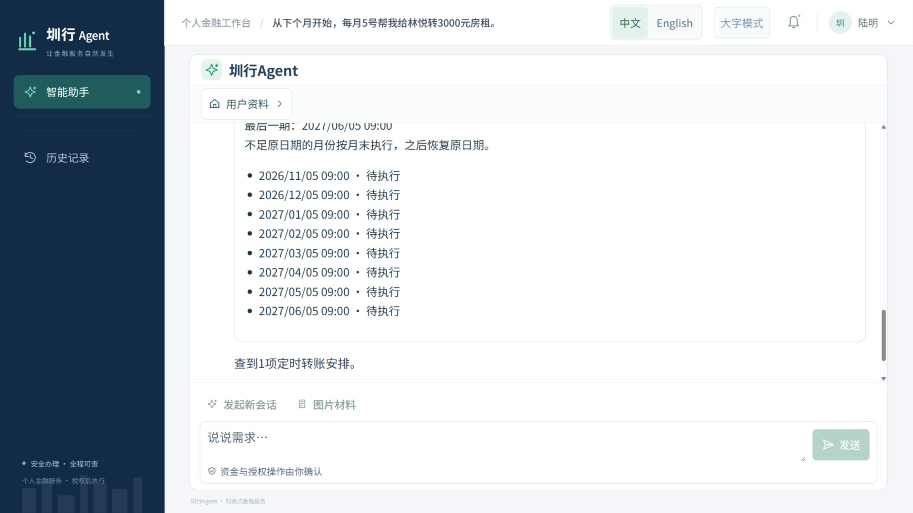](docs/screenshots/rent-occurrences.jpg)

</details>

Android运行界面、知识索引后台和实际信用卡DAG见下文对应章节。

## 六场景覆盖

| 场景 | 已实现的功能 | 重点解决的问题 | 主要实现 |
| --- | --- | --- | --- |
| 智能转账 | 按姓名、手机号或备注识别收款人；收付款卡选择；即时转账、预约、按月重复、修改与取消；AA发起、支付和追问 | 对象不明确、连续补充丢失、预约与实际付款混淆、重复执行 | 收款卡候选、参数与原话核对、确认绑定计划版本、定时任务、事务记账 |
| 账单分析 | 按卡、币种、月份或年度查询；分类分析、退款与资金搬移识别、异常线索、简短点评 | 多卡重复统计、期间混用、拿旧结果回答新问题 | 统计范围约束、经济分类、规则检测、查询结果事实引用 |
| 理财操作 | 产品咨询与比较、八题风险测评、持仓查询、申购、赎回及后续追问 | 推荐与风险不匹配、把旧持仓当作最新持仓、成交后对象丢失 | 独立风险资料、适当性检查、持仓账本、成交身份与结果引用 |
| 卡片管理 | 独立借记账户；双币信用卡、消费、账单、还款、分期；申请审批、激活、调额、锁卡、挂失 | 两卡共用余额、把授信当现金、卡状态与交易能力不同步 | 分卡账户、共享授信池、信用负债账册、审批分权、付款前状态检查 |
| 订阅与代扣 | 区分价格咨询、已有服务、开通、续订与取消；自动续费设置及权益查询 | 问价格却查订阅、恢复开关却购买新周期、取消扣费后误报权益失效 | 产品知识、条款版本、扣款授权与权益分离、独立确认 |
| 跨场景联动 | 组合查询；查信用卡欠款→还款→复查；家庭生日资料、预算预留、定时下单及状态查询 | 多步依赖不清、未来授权失控、失败后资金状态不明 | DAG安排步骤、限定授权范围、资金预留、任务持久保存、防重复下单与失败补偿 |

家庭协助、股票与贵金属持仓、低碳积分及权益是扩展能力。股票与贵金属目前仅做查询。

可以这样开始一段对话，卡号和对象以本环境实际资料为准：

| 使用方式 | 对话示例 |
| --- | --- |
| 连续补充 | “给家人转点钱。” → “十二块三毛四。” → 选择收款卡和付款卡 |
| 多对象追问 | “看看我的两张借记卡。” → “只看第二张的本月支出。” → “去年呢？” |
| 预约交房租 | “每月5号给房东转3000元房租，到年底结束。” → 核对收款人与预约设置 |
| 订阅意图区分 | “视频会员多少钱？” → “我现在开通了吗？” → “帮我开通一个月。” |
| 跨步骤追问 | “查下信用卡欠款，帮我全部还清，再看看可用额度。” |

缺少必要信息时，Agent在原对话中追问；涉及付款时进入页面确认。

## 一轮对话如何处理

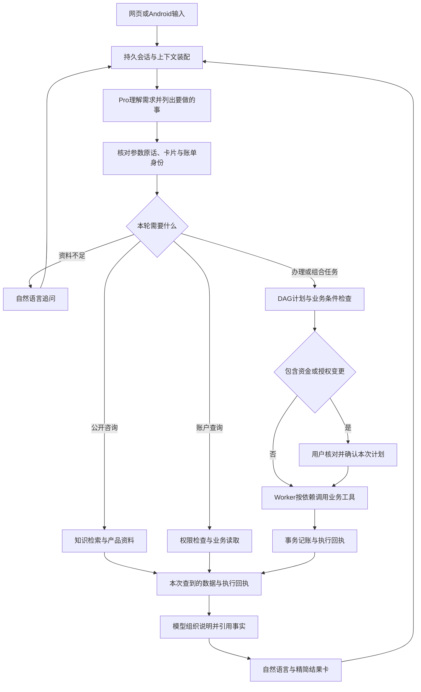

查询先确定查什么、查哪个对象、沿用哪个期间，再读取数据并回答。公开规则来自知识库，余额、持仓、欠款和订阅状态来自业务工具；没有查到的内容不能由模型补造。

常见流程是“模型理解需求→工具查询或办理→模型根据结果回答”。部分格式明确的只读请求可由程序直接识别，咨询、补充信息、重试和多步任务的模型调用次数也会不同。点击确认不一定需要再次调用模型。页面上的逐字显示由前端实现，不是模型生成一个字就立即传回一个字。

## 连续对话与结果追问

连续对话同时保存**消息、任务、对象和执行结果**：

1. **持久消息。** `ChatThread`、`ChatTurn`及相关状态保存在数据库中，同一会话按顺序处理。
2. **判断正在办哪件事。** “改成20元”是在修改当前计划，“再转一笔”是在提出新需求。每个计划都有版本号，旧确认不能用于修改后的计划。
3. **记住正在说的卡和账单。** 用户说“第二张”“这笔”“还有谁没付”时，系统要明确对应哪张卡、哪笔业务或哪份AA账单。
4. **控制发给模型的历史长度。** 整理历史消息、当前任务、已选卡片和最近结果，在长度限制内保留关键资料。
5. **继续查询已办业务。** 已完成的业务仍可继续追问，需要最新状态时重新查询；新的资金操作需要重新确认。
6. **回答失败不会重新付款。** 业务结果和回复任务分别保存。说明生成失败时重试回答，不重复执行交易。

对应实现：[会话服务](app/src/zhenxing/conversation_service.py) · [上下文装配](app/src/zhenxing/semantic_context.py) · [任务焦点](app/src/zhenxing/semantic_task_focus.py) · [上下文预算](app/src/zhenxing/semantic_context_budget.py) · [回复任务](app/src/zhenxing/customer_reply_jobs.py)

## 关键技术与源码

| 环节 | 核心技术 | 在项目中的作用 | 实现位置 |
| --- | --- | --- | --- |
| API与数据 | FastAPI、Pydantic、SQLAlchemy、PostgreSQL | 将身份、会话、任务、确认、账务和审计记录保存在数据库中 | [API](app/src/zhenxing/app.py)、[会话模型](app/src/zhenxing/conversation_models.py) |
| 需求理解 | 能力目录、结构化语义提案、字段类型编译 | 模型判断是咨询、查询、开通、修改还是取消；程序把提案转换成业务动作，并检查参数来源和类型 | [能力目录](app/src/zhenxing/capability_catalog.py)、[语义路由](app/src/zhenxing/semantic_router.py)、[参数编译](app/src/zhenxing/semantic_proposal.py) |
| 公开知识 | 本机ONNX Embedding、pgvector、混合检索 | 检索规则与产品资料，检查版本、有效期和向量模型指纹 | [检索服务](app/src/zhenxing/retrieval_service.py)、[索引Worker](app/src/zhenxing/knowledge_index_runner.py) |
| 任务执行 | DAG、持久队列、行锁、状态机 | 保存步骤依赖、领取任务、恢复中断、查询原结果 | [运行时](app/src/zhenxing/runtime.py)、[运行模型](app/src/zhenxing/runtime_models.py)、[Worker](app/src/zhenxing/worker.py) |
| 账务 | 金额按分等最小单位用整数计算、数据库事务、唯一约束 | 分币种记账，防止重复扣款，核对双方余额与授信变化 | [内部转账](app/src/zhenxing/internal_banking.py)、[信用原子操作](app/src/zhenxing/credit_atomic.py) |
| 结果回答 | 事实引用、结果指纹、回复快照 | 回答引用本次查到的记录；程序填入金额、日期、卡片和状态，并识别已经过期的结果 | [回复网关](app/src/zhenxing/customer_reply_gateway.py)、[结果呈现](app/src/zhenxing/customer_response.py) |
| 网页交互 | React、TypeScript、Vite、短轮询 | 会话恢复、逐字呈现、折叠卡片、确认及资料主页 | [网页源码](app/web/src)、[逐字呈现](app/web/src/replyTextReveal.ts) |
| 移动入口 | Java Activity、System WebView、内置网页资源 | 复用后端业务，处理视口、文件选择、来源限制和连接 | [MainActivity](mobile/android-client/src/com/zhenxing/agent/local/MainActivity.java)、[移动端技术](docs/移动端技术说明.md) |

## 信用卡多步流程与DAG

用户说“先查信用卡欠款，再用借记卡全部还清，最后看看还欠多少、可用额度恢复到多少”，系统可拆成以下依赖：

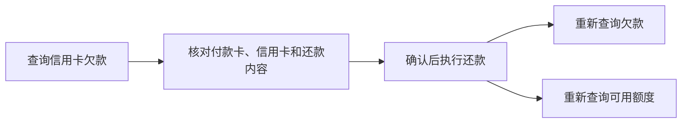

DAG是用来安排步骤先后关系的任务图，查询和还款仍由各自的业务工具执行。这里要先还款成功，再复查欠款和额度；这两项复查之间没有先后要求。每一步都保存状态、版本、参数和回执，前一步未成功时，后面的资金操作不能提前执行。

信用卡使用人民币计价的共享授信池支持人民币与美元，额度与现金余额分别处理。账单区分已出账应还、未出账消费及总欠款；还款后同时核对付款卡扣款、信用卡欠款减少和可用额度恢复。

对应实现：[信用卡运行时](app/src/zhenxing/credit_runtime.py) · [还款闭环](app/src/zhenxing/credit_repayment_closure.py) · [信用卡业务测试](app/tests/test_credit_payment_domain.py)

**实际任务依赖图 · 2026-10-25。** 后台展示已完成的查账、还款、欠款复查和额度复查四个节点：

[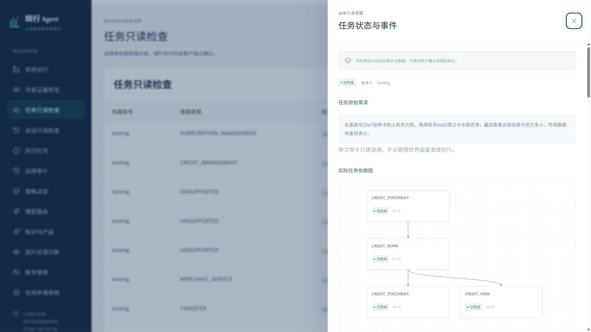](docs/screenshots/admin-credit-dag.png)

生日计划进一步涉及跨时间执行：先确认预算、付款卡、商品、地址和授权期限，再按计划预留、下单及查询履约；变更超出授权范围时重新确认。发生局部失败时按已经形成的业务事实处理补偿或查单，不把所有外部动作都视作可直接回滚。

## 风控、确认与幂等

| 控制点 | 执行约束 |
| --- | --- |
| 参数从哪里来 | 金额、币种、卡片和备注要能对应到用户说过的话，或系统已提供的卡片、账单记录；范围金额不能擅自选一个数 |
| 账户与角色 | 查询和资金动作均检查当前身份；家庭关系不自动授予代付款权限，管理身份不能替客户付款 |
| 金额与卡状态 | 检查余额、单笔及日累计限额、卡片锁定或挂失状态、收款限制及异常频次 |
| 风险隐私 | 收款限制使用交易风控来源，不读取或向付款人透露对方信用卡账单 |
| 本次确认 | 绑定任务、计划版本、对象及参数；修改金额或卡片后，旧确认不能沿用 |
| 大额与敏感操作 | 核对操作验证码与本次确认；当前同屏验证码不是独立的多因素身份验证（MFA） |
| 重复与并发 | 用幂等键识别同一请求，限制一份确认只能使用一次，再用数据库唯一约束和行锁防止并发重复执行 |
| 失败恢复 | 暂时不知道付款结果时，先查原来那笔交易；不能因页面没收到回复就重新付款 |
| 提示词注入 | 用户文本、检索材料、附件和历史结果不能扩大工具权限；结构、来源、授权与业务条件仍由程序检查 |

当前项目内转账策略包含：人民币单笔5万元、单日人民币等值10万元；同一收款账户当日已有两笔各至少1万元的成功转账后，再次发起高值转账会被拒绝。具体还受卡片限额、余额和收款限制约束。这些是项目策略，不是银行统一标准，见[转账风控](app/src/zhenxing/transfer_risk.py)。个人信用卡账单状态不作为向其他付款人发出风险提醒的依据。

已保留的真实模型拦截案例包括：范围金额“1.2到1.5万元”被作为转账参数提出后，被 `SEMANTIC_MONEY_NOT_EXACT` 拒绝；未绑定具体身份的“这张信用卡”被作为卡号字段提出后，被 `SEMANTIC_FIELD_NOT_EXACT` 拒绝。两次均未进入银行写操作。第二例的句内指代后续已定向修复，旧拦截记录保留。

案例原文与提案见[原话校验拦截案例](evidence/原话校验拦截案例.json)。安全边界见[安全说明](SECURITY.md)；测试入口见[确认与权限](app/tests/test_runtime_security.py)、[请求幂等](app/tests/test_request_idempotency.py)、[重复请求与账务核对](app/tests/test_idempotency_report_evidence.py)、[资料来源信任](app/tests/test_consultation_source_trust.py)。

## 知识检索与模型选择

### 本机RAG

RAG的做法是先从资料中找出相关内容，再交给模型回答。公开规则和产品说明放在独立的PostgreSQL知识库中，用pgvector检索。Embedding负责把文字转换成用于检索的向量，在本机CPU上运行；聊天与规划调用DeepSeek API。

本机向量模型为 `sentence-transformers/paraphrase-multilingual-MiniLM-L12-v2`，输出384维向量。索引和查询时都会检查模型文件的哈希，确认使用同一版模型。

检索同时按关键词和文字含义找资料，再合并、筛选结果，具体使用HNSW向量召回、词法排序和RRF融合。默认最多返回6个片段，每篇文档最多2个；返回前还要检查资料是否已发布、是否允许当前角色查看、是否过期，以及内容有没有变化。

2026-10-30新环境部署验证中，54篇文档、342个片段完成索引，实际检索返回 `READY / HYBRID`。这些数字属于该版语料和部署快照，见[发布验证摘要](evidence/发布验证摘要.json)。

**知识与索引后台 · 2026-10-25。** 页面展示文档与向量覆盖、模型指纹、服务探活和实际检索模式：

[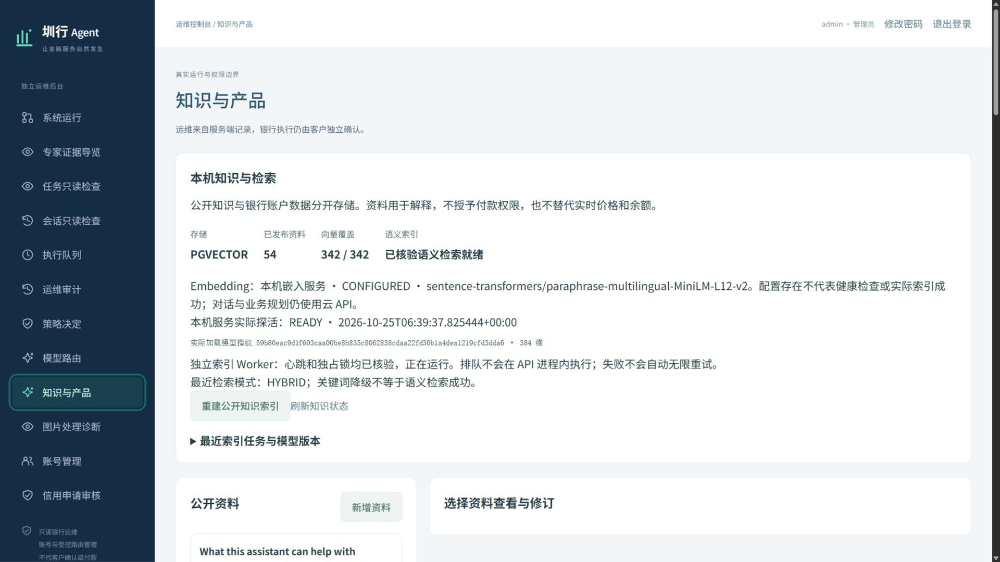](docs/screenshots/admin-knowledge.png)

### Pro、Flash与Laya

当前主要对话链路默认使用 `deepseek-v4-pro`。原先尝试让Laya先判断细分场景与难度，简单查询分给Flash，复杂请求交给Pro；实测未形成有效分流，因此未默认启用前置Laya路由。

以下为2026-10-20固定20条开发样本的**语义选择阶段**记录：

| 方案 | 平均耗时 | P50 | P95 | 严格意图标签匹配 |
| --- | ---: | ---: | ---: | ---: |
| 全部Pro | 2874.18 ms | 2437.98 ms | 6168.70 ms | 18/20 |
| 全部Flash | 1707.10 ms | 1536.93 ms | 2698.39 ms | 16/20 |
| Laya前置混合 | 3337.12 ms | 2902.42 ms | 6682.76 ms | 18/20 |

混合组平均比Pro慢462.94 ms，约16.1%。在当次0.95的置信度阈值下，20条请求最终都交给Pro处理，Laya增加了判断时间，却没有分担请求。这次耗时只统计语义选择阶段，不包含工具执行和最终回答；标签匹配也不等于所有参数都正确。当前Compose设为 `ZX_LAYA_MODE=OFF`；保留的影子模式只记录建议，不影响实际办理。原始核算见[Laya对照摘要](evidence/Laya对照摘要.json)及[评测核算数据](evidence/评测核算数据.json)。

图片提取是另一条模型调用链，当前 `vision_gateway.py` 固定请求 `deepseek-flash`，与主对话模型配置分别验收；文字对话可用不代表图片服务已可用。

## 网页、Android与管理后台

| 入口 | 功能与技术 |
| --- | --- |
| 网页工作台 | 连续对话、用户资料主页、精简结果卡、页面确认、图片材料；逐字显示由前端实现 |
| Android 0.1.1 | Java / System WebView，APK内置React网页资源；通过显式开启的私网网关访问同一FastAPI后端 |
| 管理后台 | 账号及申请管理、信用账务状态与策略审计（管理员私有）、知识文档与索引、模型配置、任务运行状态与审计查看；具体权限由服务端检查 |

Android默认86%布局缩放，支持双指缩放；系统文件选择器最多接收5张图片，每张不超过5MiB。客户端限制服务来源，切换来源时清理旧存储，模型密钥留在电脑服务端。

**Android 0.1.1实际运行 · 2026-10-29。** 用户从银行卡余额继续追问信用卡可用额度：

<p align="center">
  <a href="docs/screenshots/android-credit.png">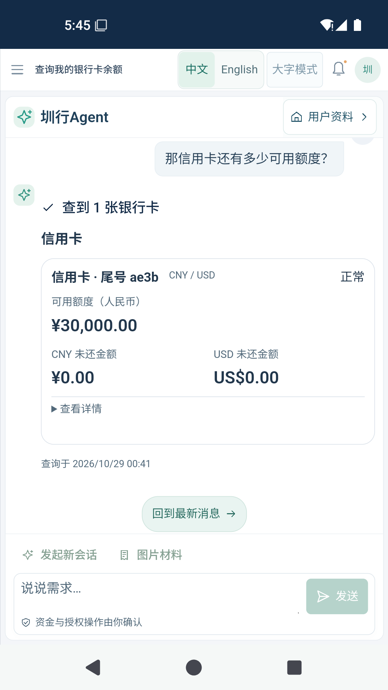</a>
</p>

网页与APK共用业务服务，APK内置界面是独立快照，修改网页不会自动更新已安装应用。安装包、校验值和构建方法见[Android发布文件](mobile/dist)、[移动端构建](mobile/BUILDING.md)、[手机连接](docs/手机连接.md)及[移动端验证](docs/移动端验证说明.md)。

## 评测与验证记录

### 真实模型评测 · 2026-10-26

| 指标 | 记录 | 口径 |
| --- | --- | --- |
| 严格意图匹配 | 44/48，91.67% | 六场景各8条固定开发样本，同时检查模式与动作集合 |
| 预标注关键字段 | 37/37，100% | 仅18条普通样本中的37个字段，未覆盖所有参数及额外字段错误 |
| 即时人民币转账首轮完成 | 6/12，50% | 含4条模型服务HTTP 402中断及2条应用失败 |
| 服务恢复后合并记录 | 10/12，83.33% | 只续测4条服务中断样本；原成功和应用失败未重新执行 |
| 应用失败定向修复 | 2/2原句复验通过 | “一块零三分”和英文备注，单独保留修复记录；未据此重算整组为12/12 |

转账成功要求核对固定对话、确认、任务结果、唯一转账及双方余额变化。该组未覆盖预约、AA或跨币种完成率。固定开发题集不能外推为全部用户请求准确率。

**纯模型对照：** 对同一批60次模型输出，一份保留模型原来的提案，另一份交给程序检查结构、参数来源和类型。4条不确定或不合法的金额提案全部被拒；11条意图标签不符合预设答案的输出中，检查拦住5条，另6条仍通过；还有1条标签正确但结构无效的输出被拒。比较到这一步就结束，没有执行未校验的付款，因此这组数据只能说明程序检查拦住了哪些提案，不能用于比较两个完整系统的交易成功率。

详细记录：[效果评测摘要](evidence/效果评测摘要.json) · [逐项核算与修复记录](evidence/评测核算数据.json) · [本地核算脚本](evidence/verify_metrics.py)

### 发布与部署验证 · 2026-10-30

| 检查 | 结果与范围 |
| --- | --- |
| 安全测试 | 370/370通过；固定12个测试文件，覆盖来源、角色、确认、重放、附件、隐私、限额与恢复 |
| 初始化与配置 | 7/7通过；检查空库初始化、重复运行保留数据、失败回滚、登录凭据与默认入口 |
| 前端测试 | 11个文件101/101通过，另完成TypeScript与Vite构建 |
| 核心业务测试 | 首轮454/455；剩余1条是过时的订阅目录测试断言，更新测试后单例通过，未重新执行全部455条 |
| 独立Docker部署 | 新项目及新PostgreSQL卷；API、业务Worker、知识索引与Embedding就绪 |
| 新环境真实对话检查 | 11轮对话完成，记录中确认有Pro调用；1.03元转账核对双方余额，重复确认返回HTTP 409，额外扣款0 |

各组检查的内容不同，分别报告结果。多数行为测试使用独立的SQLite数据库和预设模型返回结果；新环境部署与真实云模型对话另有记录。GitHub自动检查运行构建、初始化、精确金额和幂等等基础测试，不代替完整安全测试或真实对话验收。

证据入口：[发布验证摘要](evidence/发布验证摘要.json) · [安全选集结果](evidence/发布候选安全验收.json) · [JUnit](evidence/发布候选安全验收.xml) · [核心流程验收](evidence/2026-10-28核心流程验收.json) · [GitHub检查记录](https://github.com/cnqiujunhu-dev/zhenhang-agent/actions)

## 快速启动

准备Docker Engine或Docker Desktop（Linux容器、Compose v2），以及主机Python 3.11或以上。首次构建需要联网下载镜像、依赖和Embedding权重；需要自己的DeepSeek API密钥、模型权限和可用余额。电脑建议4核、16GB内存、20GB可用磁盘，这是演示资源建议，未做容量上限测评。

```shell
git clone https://github.com/cnqiujunhu-dev/zhenhang-agent.git
cd zhenhang-agent/app
python configure_local.py
```

编辑新生成的 `.env`，填写 `ZX_DEEPSEEK_API_KEY`，然后在同一目录运行：

```shell
docker compose -p zhenxing_submission config --quiet
docker compose -p zhenxing_submission up -d --build
docker compose -p zhenxing_submission ps -a
```

`init-data` 成功后显示 `Exited (0)`；API和业务Worker等待初始化完成。Embedding首次下载及索引需要额外时间，页面打开后还应核对服务与索引就绪状态。

- 网页工作台：`http://127.0.0.1:18965/#/workspace`
- 管理后台：`http://127.0.0.1:18965/#/admin`
- 初始用户名与口令：电脑本地 `app/var/private/首次登录.txt`，管理员 `admin` 使用独立口令。
- 推荐先用 `wangwei` 查看资料，再用 `qiujunhu` 验证平台内收款。完整卡号由新环境生成，先查询再操作。

配置脚本生成随机本机凭据，拒绝覆盖已有 `.env`。密钥和私有登录文件不要上传；完整部署、健康检查、日常启停和排错见[部署说明](docs/部署说明.md)、[首次验收清单](docs/首次验收清单.md)及[排错](docs/排错.md)。

## 初始化数据

源码提供空库初始化器，无需导入开发机运行数据库。首次启动默认当天为账单基准日；也可在首次启动前设置 `ZX_SEED_AS_OF=YYYY-MM-DD`。

| 数据 | 默认内容 |
| --- | --- |
| 身份 | 14个业务账号及1个管理员，包含普通客户、家庭成员和受限开发测试身份 |
| 借记卡 | 28张；每个业务账号2张，人民币账户独立，按原总额70%/30%分配 |
| 信用卡 | 14张双币信用卡；每户448元已出账、588元未出账，总欠款1036元，前期344元已结清 |
| 账单 | 最近12个月10,416条初始现金流水，84笔信用消费、28份信用账单 |
| 服务 | 每户2项订阅；持仓、产品资料、股票与贵金属查询、100初始积分 |
| 家庭与商户 | 28条收款别名、28条生日；14账套各3项商户商品，另有家庭关系和有效委托 |

完整初始化在事务和版本标记下完成，重新运行保留已有业务状态；非空且无本版标记的数据库会拒绝初始化。样例没有预先授权未来付款。账户类型、美元钱包分布和数据口径见[初始化数据与演示账号](docs/样例数据.md)及[数据验收](evidence/示例数据验收.json)。

## 工程目录与开发验证

```text
zhenhang-agent/
├─ app/
│  ├─ src/zhenxing/       API、对话、知识、业务工具、DAG与初始化
│  ├─ web/               React / TypeScript网页及行为测试
│  ├─ tests/             明确选定的后端测试与辅助模块
│  ├─ deploy/            容器与本机Embedding配置
│  └─ compose.yaml       六个常驻服务及一次性init-data
├─ mobile/
│  ├─ android-client/    Java入口、资源、兼容脚本和私网网关
│  ├─ web/               APK对应的网页源码与锁文件
│  └─ dist/              APK、版本信息与校验值
├─ docs/                 部署、数据、移动端、测试与已知限制
├─ evidence/             筛选后的评测及验证记录
├─ licenses/             内置第三方依赖的许可证
└─ SOURCE_MANIFEST.json  文件清单与SHA-256
```

安装锁定的测试依赖后，可在 `app` 中运行相关选集：

```shell
python scripts/run_checks.py --suite bootstrap
python scripts/run_checks.py --suite security
python scripts/run_checks.py --suite core
```

前端在 `app/web` 中运行：

```shell
npm ci
npm run build
node --test tests/*.test.mjs
```

依赖安装、隔离策略、测试分组和Android检查见[测试说明](docs/测试说明.md)。其他入口：[源码目录](SOURCE_LAYOUT.md) · [第三方组件告知](THIRD_PARTY_NOTICES.md) · [依赖说明](docs/第三方依赖说明.md)。

## 适用范围与待接入能力

项目提供本机可运行的业务环境与模拟账务，应用内记录不代表外部银行清算或商户真实配送。AA、订阅代扣、生日订单等合作接口仍需接入；异常交易提示是核对线索，不是对欺诈事实的认定。

默认服务绑定 `127.0.0.1`，Android的HTTP网关用于可信局域网。对公网或真实客户数据提供服务前，还需独立认证、HTTPS、管理员隔离、图像服务准入及外部渠道验收。当前图片材料经服务端处理后仍会发送外部视觉API，应单独核对使用范围。

已有本机独立Docker及安卓模拟器相关验证，实体手机、其他主机与操作系统兼容性仍需复验；暂无iOS、离线业务执行或生产安全认证结论。详细边界见[已知限制](docs/已知限制.md)与[安全说明](SECURITY.md)。
